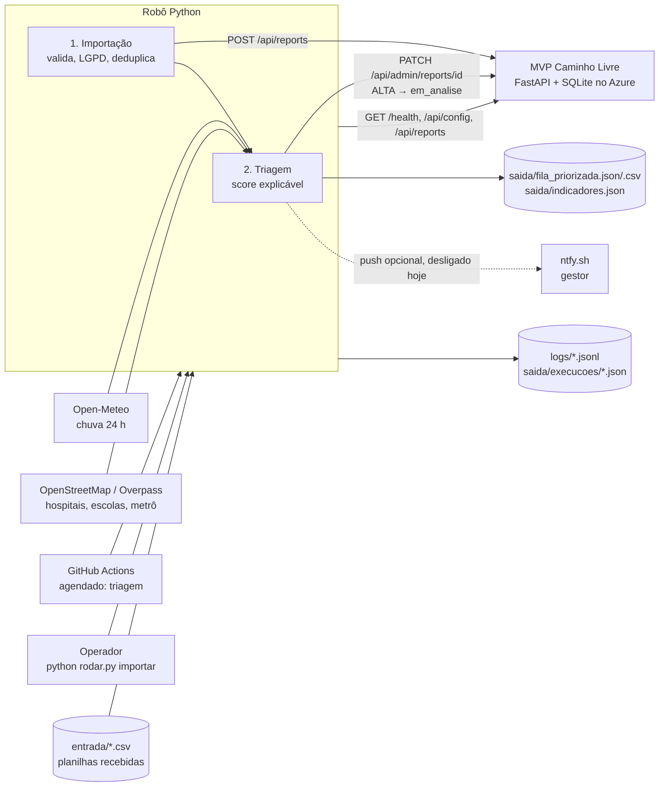

# Caminho Livre · Robô de importação e triagem (RPA)

Global Solution FIAP 2026.2 (CitizenTech), Engenharia de Software 4º ano.
Disciplina **Robotic Process Automation**, atividade *Do Processo Manual à Automação Inteligente*.

Este repositório traz o componente **Automação** do MVP [Caminho Livre](https://caminholivre-gs.azurewebsites.net): um robô em Python que tira do gestor duas tarefas manuais. A primeira é redigitar no mapa os relatos de barreiras que chegam por planilha. A segunda é decidir, relato por relato, o que atacar primeiro.

> **O que é real e o que é cenário.** A triagem roda sozinha no GitHub Actions contra o MVP público e já mudou relatos para "em análise" em produção (evidências [abaixo](#o-que-já-aconteceu-em-produção)). A importação de planilhas também funciona contra o MVP real, mas **não existe convênio com a central 156, vistorias ou ONGs**: esses canais são o cenário que justifica a automação, e a planilha de exemplo é fictícia, montada com endereços reais do piloto. A importação de 14/11 usou uma versão anterior dela, com cada linha marcada como `[demonstração]`.

| | |
|---|---|
| **MVP (público)** | https://caminholivre-gs.azurewebsites.net |
| **Repositório do MVP** | https://github.com/santos-nikolas/caminho-livre |
| **Vídeo da automação** | https://www.youtube.com/watch?v=SV06vN_nMxM |
| **Relatório técnico** | [`docs/relatorio-rpa.pdf`](docs/relatorio-rpa.pdf) |
| **Desenho do processo (BPMN)** | [`docs/processo-robo.bpmn`](docs/processo-robo.bpmn) · [imagem](assets/bpmn-processo-robo.png) |

## Integrantes

| Nome completo | RM |
|---|---|
| Guilherme Rocha Bianchini | RM97974 |
| Nikolas Rodrigues Moura dos Santos | RM551566 |
| Thiago Jardim de Oliveira | RM551624 |
| Rodrigo Brasileiro | RM98952 |

## Ficha Técnica do MVP (resumo)

| Campo | Conteúdo |
|---|---|
| Produto | Caminho Livre: mapa colaborativo de barreiras de acessibilidade em calçadas e travessias |
| Cidadão e território | Pedestres com deficiência ou mobilidade reduzida, idosos e cuidadores. Piloto no entorno do campus FIAP Paulista (SP), cerca de 1,2 km × 1,5 km |
| Problema | Barreiras são relatadas de forma dispersa e ninguém acompanha se foram resolvidas |
| Papel desta automação | Leva para o MVP os relatos que chegam por outros canais e entrega ao gestor uma fila priorizada e explicada |
| ODS | 10 (redução das desigualdades) e 11 (metas 11.2 e 11.7) |

## O processo manual que o robô substitui

| Antes (manual) | Depois (robô) |
|---|---|
| Relatos que chegam fora do app, em planilha (cenário: central 156, vistorias, ONGs). Alguém redigitaria cada linha no mapa | Quem recebe a planilha a coloca em `entrada/` e roda `python rodar.py importar`. O robô valida, limpa e cria os relatos pela API |
| Planilhas trazem nome e telefone de quem relatou | Dados pessoais são descartados antes do envio (LGPD) |
| A mesma barreira entra duas vezes, por canais diferentes | Duplicatas a até 15 m, da mesma categoria, são detectadas e não entram |
| O gestor abre o mapa e decide no olho o que é urgente | Cada relato aberto recebe um score explicável, cruzado com hospitais, escolas, metrô (OpenStreetMap) e previsão de chuva (Open-Meteo) |
| Casos urgentes esperam alguém perceber | A cada execução agendada, relatos de prioridade ALTA ainda pendentes passam para "em análise" no MVP, sem ninguém disparar nada |

## Arquitetura



**Por que Python e não UiPath ou Power Automate:** todas as fontes têm API (o MVP, o Open-Meteo e o OpenStreetMap), então não há tela para o robô clicar. Em Python o robô fica versionado, testado no CI e roda de graça no agendador do GitHub Actions, que a equipe já usa no componente de DevOps. O robô usa **só a biblioteca padrão** do Python 3.11+, então não há nada para instalar.

## Como rodar

```bash
git clone <este repositório> && cd <pasta>
cp .env.example .env          # MVP_ADMIN_TOKEN para mudar status; NTFY_URL (opcional) para push

python rodar.py executar --simular   # lê tudo e mostra o que faria, sem alterar o MVP
python rodar.py executar             # importa entrada/*.csv e faz a triagem
python rodar.py importar             # só a etapa 1
python rodar.py triagem              # só a etapa 2
python rodar.py executar --demonstracao   # marca os relatos criados com [demonstração] (planilhas de exemplo)

python scripts/demo_local.py         # demonstração completa contra um MVP falso local (sucesso, decisão e falha)
python scripts/demo_local.py --pausar   # o mesmo, esperando Enter entre as cenas (para gravar)
```

Para ver a importação sem tocar a produção, use `scripts/demo_local.py`: ele sobe um MVP falso iniciado com a cópia pública dos relatos de produção (`exemplos/mvp-producao-copia.json`) e os locais reais do OpenStreetMap, e importa as planilhas de `exemplos/`. A chuva é simulada com 8,4 mm, o valor real de 16/11. Para importar as planilhas de exemplo no MVP de produção, como no vídeo, use `--demonstracao`: elas são fictícias, e os relatos criados ficam marcados com `[demonstração]` no mapa público. Ensaie antes com `--simular`, que não grava nada.

Código de saída: `0` para SUCESSO ou SUCESSO_COM_ALERTAS, `1` para FALHA. O agendador marca a execução como vermelha quando a saída é `1`.

### Agendamento (mínima intervenção humana)

`.github/workflows/robo.yml` roda os testes a cada push. Pelo agendamento (`cron: "0 * * * *"`) e pelo botão *Run workflow*, ele também executa o robô contra o MVP público. Os logs e as saídas de cada execução ficam 30 dias como artefato da execução no Actions.

Como funciona na prática:

- **O GitHub não garante o horário.** O cron pede uma execução por hora, mas o GitHub atrasa ou pula execuções agendadas quando está com carga. Entre 14/11 e 17/11/2026 foram 10 execuções agendadas, com intervalos de 3,5 a 10 horas ([print](assets/actions-agendadas.png)). Todas terminaram com sucesso.
- **No Actions, o robô faz a triagem.** A pasta `entrada/` não é versionada (as planilhas podem ter dados pessoais), então a caixa de entrada no Actions está sempre vazia e o log registra `0 arquivo(s) na caixa de entrada`. A importação roda na máquina de quem recebeu a planilha.
- **Segredo configurado:** só `MVP_ADMIN_TOKEN`. O `NTFY_URL` não está configurado, então o push para o gestor está desligado. O robô registra `notificacao_desativada` no log. Quando uma execução agendada termina em FALHA, ela fica vermelha no Actions, e o GitHub manda e-mail a quem mantém o workflow (configuração padrão de notificações do GitHub).

## Estrutura

```
src/robo/            código-fonte
  robo.py            orquestrador: trava, etapas, status final
  importacao.py      etapa 1: lote de CSVs → API do MVP
  triagem.py         etapa 2: prioridade, mudança de status, fila e indicadores
  regras.py          regras de negócio puras (validação, duplicata, score)
  fontes.py          conectores: MVP, Open-Meteo, Overpass, ntfy
  http_cliente.py    timeout, novas tentativas e backoff exponencial
  auditoria.py       logs JSON Lines e resumo por execução
  estado.py          SQLite local: idempotência e cache
  lgpd.py            mascaramento e minimização de dados pessoais
rodar.py             ponto de entrada
dados/               snapshot versionado dos locais sensíveis (OSM, ODbL)
exemplos/            planilhas fictícias (endereços reais do piloto) e cópia pública dos relatos de produção para o demo
docs/                BPMN, PDD e relatório técnico
assets/              imagens e evidências visuais
logs/amostras/       logs reais gerados, sem dados pessoais
tests/               testes automatizados e evidências
scripts/             demonstração local
```

## Regras de negócio

**Validação de cada linha (decisão):** a linha precisa de coordenada numérica (aceita `-23,5646`, do Excel em português), dentro do território do piloto, que o robô lê de `GET /api/config`, e uma categoria reconhecida. Sinônimos como "Calçada obstruída", "rampa" ou "faixa sem rebaixamento" são normalizados. Linha inválida é rejeitada, com o motivo no log, e as outras linhas seguem.

**Duplicata (decisão):** um relato aberto (pendente ou em análise) da mesma categoria a até 15 m. A linha não é criada e o log aponta o relato existente.

**Idempotência:** cada linha gera uma impressão digital (SHA-256 dos dados já normalizados e sem dado pessoal). Reenviar a mesma planilha não duplica nada.

**Prioridade (decisão), explicável ponto a ponto:**

| Fator | Pontos |
|---|---|
| Categoria: rampa bloqueada / travessia com barreira / calçada obstruída | 40 / 35 / 25 |
| Cada dia aberto | +5 (teto 30) |
| Hospital, clínica, escola, assistência social ou acesso ao metrô a ≤ 100 m / ≤ 200 m | +20 / +10 |
| Chuva prevista ≥ 5 mm nas próximas 24 h | +10 |
| Outros relatos abertos a até 30 m | +10 cada (teto 20) |

ALTA ≥ 70 (prazo sugerido de 2 dias), MÉDIA ≥ 45 (7 dias), BAIXA < 45 (15 dias). Cada item da fila traz a lista de `motivos`, por exemplo `"a 52 m de hospital 'Pró Matre Paulista' (+20)"`.

**Ação (decisão):** só relatos ALTA ainda pendentes mudam para `em_analise`. O robô nunca devolve um relato para `pendente`: se a chuva passa e o score cai, o relato continua em análise e a fila mostra a prioridade nova. **Pessoa no circuito:** o robô nunca marca `resolvido` nem `descartado`. Essas decisões são do gestor.

## Exceções e resiliência

| Falha | Como o robô reage |
|---|---|
| MVP fora do ar, timeout ou 5xx | 3 tentativas com backoff exponencial (2 s, 4 s). Se persistir: status FALHA, código 1 (execução vermelha no Actions), push se `NTFY_URL` estiver configurado, e o arquivo fica na entrada |
| MVP cai no meio de um lote | Para, mantém o arquivo e, na próxima execução, envia só as linhas que faltaram (idempotência) |
| MVP recusa uma linha (422) | Registra o motivo, marca a linha como rejeitada e segue com as outras |
| Token de gestor inválido (401) | FALHA explícita `token_invalido`, sem tentar de novo |
| Sem token configurado | Prioriza e grava a fila, mas não muda status, com um alerta no log |
| Arquivo vazio, sem colunas obrigatórias, binário ou `.xlsx` | Vai para `entrada/quarentena/` com um `.motivo.txt` |
| Pasta de entrada ausente | Alerta, e a triagem roda mesmo assim |
| Open-Meteo fora | Segue sem o fator chuva e registra `fatores_indisponiveis` na fila |
| Overpass (OSM) fora | Tenta um espelho, depois o cache local, depois o snapshot versionado em `dados/`, e só então segue sem o fator |
| Push para o gestor falha | Alerta `notificacao_falhou` no log e status SUCESSO_COM_ALERTAS. A mudança de status no MVP já foi feita |
| Duas execuções ao mesmo tempo | Trava em arquivo: a segunda é ignorada, com registro |
| Erro inesperado | Capturado, registrado com o tipo e terminado com status FALHA. Nada falha em silêncio |

## Logs e auditoria

- `logs/robo-AAAA-MM-DD.jsonl`: um evento por linha, com `ts` (UTC), `run_id`, `nivel`, `etapa`, `evento`, `mensagem`, arquivo e linha ou `relato_id`.
- `saida/execucoes/<run_id>.json`: resumo da execução (início, fim, status, contadores, alertas e erros).
- Amostras reais em [`logs/amostras/`](logs/amostras/).
- Campos como `contato`, `nome`, `telefone`, `email` e `descricao` são removidos antes da gravação, e toda mensagem passa por um mascaramento de telefone, e-mail e CPF.

## Integração com o MVP

| Direção | Contrato |
|---|---|
| Robô → MVP | `POST /api/reports` cria os relatos importados. `PATCH /api/admin/reports/{id}` com `{"status":"em_analise"}` e o token de gestor |
| MVP → Robô | `GET /health`, `GET /api/config` (território), `GET /api/reports` |
| Robô → gestor | `saida/fila_priorizada.json` e `.csv` (fila ordenada com motivos) e `saida/indicadores.json`. No Actions, ficam como artefato de cada execução. Nenhum outro sistema lê esses arquivos hoje: quem consome o resultado do robô é o MVP, pela API |

O resultado pode ser conferido no próprio mapa: os relatos importados aparecem como pins novos e os de prioridade ALTA mudam para "em análise".

### O que já aconteceu em produção

| Data (UTC) | Execução | O que o robô fez no MVP público |
|---|---|---|
| 14/11/2026 14:01 | Manual, na máquina da equipe, com a planilha de exemplo | Criou 4 relatos `[demonstração]`, barrou 1 duplicata, rejeitou 3 linhas, mandou 1 planilha para a quarentena e removeu um telefone. O Overpass deu 502/504 e o espelho resolveu ([log](logs/amostras/producao-execucao-real.jsonl), [mapa](assets/mvp-integracao.png)) |
| 15/11/2026 10:21 | Agendada no Actions | Moveu `08fc1e17` para "em análise": travessia a 52 m do hospital Pró Matre, 70 pontos |
| 16/11/2026 20:47 | Agendada no Actions | Com 8,4 mm de chuva previstos (+10), moveu mais 3 relatos para "em análise", incluindo um enviado pela própria página do MVP em 15/11 ([log](logs/amostras/producao-agendada-em-analise.jsonl), [fila](logs/amostras/fila_priorizada-producao-agendada.json), [mapa](assets/mvp-em-analise.png)) |

Nas execuções agendadas a importação sempre encontra a caixa vazia (veja o agendamento acima). O que elas fazem é a triagem, que reavalia todos os relatos abertos a cada execução.

## Testes

```bash
PYTHONPATH=src:tests python -m unittest discover -s tests -v
```

São 45 testes, sem rede externa. Os testes de ponta a ponta usam um MVP falso (`tests/mvp_falso.py`) com as mesmas rotas e regras do MVP real e falhas programáveis.

| Cenário | Exemplos |
|---|---|
| Sucesso | importação de lote, idempotência, fila e indicadores gerados, modo simulação |
| Decisão | linhas inválidas rejeitadas com motivo, duplicata, ALTA → em análise e BAIXA mantida, chuva sobe a prioridade, robô nunca resolve nem descarta |
| Falha | MVP fora, MVP instável que se recupera, queda no meio do lote, quarentena, Open-Meteo fora, Overpass fora (cache e snapshot), token errado, execução concorrente, push que falha |
| LGPD | telefone, e-mail e nome não chegam ao MVP nem ao log |

Saída da última execução em [`tests/evidencias/resultado-testes.txt`](tests/evidencias/resultado-testes.txt).

## Segurança e LGPD

- Token de gestor só em variável de ambiente ou segredo do GitHub, nunca no código. O `.env` está no `.gitignore`.
- Minimização: a coluna `contato` nunca é lida para envio. Telefone, e-mail e CPF dentro da descrição são trocados por `[removido]` antes do envio (o MVP também sanitiza, então são duas camadas).
- Os logs não guardam a descrição nem o contato. A idempotência usa um hash dos dados já mascarados.
- Coordenadas são arredondadas a 4 casas (~11 m), a mesma precisão do MVP.
- O robô só usa HTTPS para os serviços externos e se identifica com User-Agent próprio.
- As planilhas de exemplo são fictícias. No demo local rodam num MVP falso; em produção, só com `--demonstracao`, que marca os relatos criados. Os dados pessoais nelas (nome, telefone, e-mail) são inventados, justamente para mostrar que o robô os descarta. Os 4 relatos de demonstração criados em produção podem ser marcados como "descartado" pelo gestor depois da correção.

## Fontes de dados

- **MVP Caminho Livre:** relatos dos cidadãos (API própria).
- **OpenStreetMap via Overpass API:** hospitais, clínicas, escolas, assistência social e acessos ao metrô. Licença ODbL, © colaboradores do OpenStreetMap.
- **Open-Meteo:** previsão horária de precipitação, uso não comercial gratuito, sem chave.
